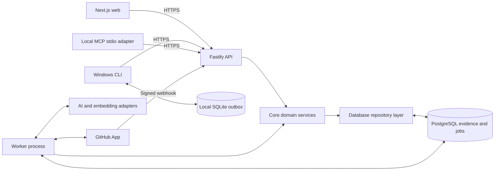
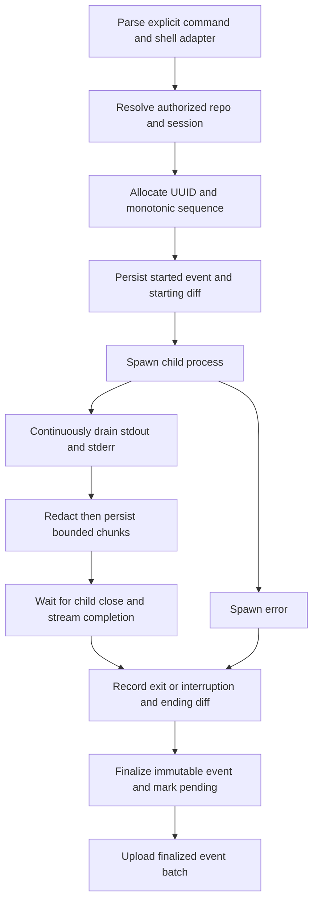

# Memvora architecture

Status: target architecture for the scratch TypeScript build. See [ROADMAP.md](ROADMAP.md) for the distinction between starter and delivered features.

## Runtime and ownership boundaries



Web, CLI and MCP never connect directly to the database. The API and worker share domain code and schema but have distinct process lifecycles. Domain modules call one another in process. Shared PostgreSQL ownership and transactions keep this a modular monolith, even though there are multiple executable applications.

The implemented local backup operator is a separate administrative boundary: `scripts/backup-local.mjs` runs on the database-owning machine with filesystem permissions and calls the SQLite backup helper in `packages/db`. Normal website, capture CLI and MCP evidence requests remain API-backed. There is no arbitrary-filesystem API route or browser raw-database download. This operator opens the existing source read-only, uses SQLite online backup into an exclusively new directory and validates the completed single-file copy before publishing its manifest. Verification performs no migration, provider request, worker processing or live restore. External credential files/outboxes remain separate; the complete database still contains private signing and encrypted connection state. See [BACKUPS.md](BACKUPS.md).

The CLI's offline outbox inspector is another explicitly local boundary: it opens only an existing capture outbox read-only and returns bounded metadata pages, without an API credential, bootstrap, migration or recovery. It exposes no browser/MCP filesystem interface. Selected sync filters stored rows before parsing, verifies the original envelope/row/bound-repository identities, and sends unchanged evidence through normal API authorization. Each attempt snapshots a row-ID cutoff, reports remaining work and acknowledges only unique IDs in the sent batch. Automatic upload after `run` targets that new event. Event-batch HTTP validation checks types without coercion so null outcomes remain observations rather than converted values; ordinary numeric URL-query parsing stays separate. See [OUTBOX_RECOVERY.md](OUTBOX_RECOVERY.md).

| Workspace            | Responsibility                                                                           | Allowed dependencies                                                     |
| -------------------- | ---------------------------------------------------------------------------------------- | ------------------------------------------------------------------------ |
| `apps/web`           | Next.js App Router interface, web session presentation, timeline and recall              | contracts and API client; no direct DB access                            |
| `apps/api`           | Fastify routes, authentication, validation, request limits, transport mapping            | contracts, core, db, server adapters                                     |
| `apps/cli`           | Command parsing, Windows capture, local persistence, pairing, sync, ask                  | contracts, client-safe core helpers and API client; local SQLite adapter |
| `apps/mcp`           | Read-only stdio tools and bounded results                                                | contracts, client-safe core helpers and API client; no shell execution   |
| `apps/worker`        | Queue lifecycle, job handlers, retry and graceful shutdown                               | core, db, provider adapters                                              |
| `packages/contracts` | Versioned DTOs and TypeBox runtime schemas                                               | no application or DB imports                                             |
| `packages/core`      | Domain services plus explicit client-safe validation, excerpts and runtime configuration | contracts and explicit ports; no implicit server bootstrap               |
| `packages/db`        | Drizzle schema, migrations, scoped queries and transaction adapters                      | contracts where useful; no client imports                                |

Supporting utility packages can be added when genuinely shared. Avoid creating a package for every function or allowing web code to import server secrets through a convenience barrel export.

The implemented private client release bundles CLI and MCP into `@memvora/clients`, with no runtime workspace links or install hooks. A small client-safe core module owns the shared version and explicit credential-source resolution; it accepts a lazy source-development fallback rather than importing server bootstrap or reading secrets on import. Both adapters continue to use the authenticated API for evidence; the capture CLI alone owns its repository-local outbox. Portable bundles require an explicit server data directory or token and never infer a server store from their installation path. The producer audits actual packed bytes against its allowlist and includes dependency licenses. See [CLIENT_INSTALLATION.md](CLIENT_INSTALLATION.md).

## Why these choices

| Decision                        | Why                                                                                                    | Cost and review trigger                                                                                       |
| ------------------------------- | ------------------------------------------------------------------------------------------------------ | ------------------------------------------------------------------------------------------------------------- |
| TypeScript throughout           | Shared language, types and validation contracts across website, CLI, API and MCP                       | Types alone do not validate network data; keep runtime schemas. A rewrite alone is not a measured speed gain. |
| Next.js UI plus Fastify API     | Rich web interface plus a stable API for three clients; explicit Node process for hooks and middleware | Additional process versus a web-only backend. Keep business logic out of route components.                    |
| Modular monolith                | Transactions, simpler debugging and fewer distributed failure modes for a small team                   | Enforce module boundaries; do not let one oversized service own every concern.                                |
| Separate worker                 | Slow imports, provider calls and retries cannot delay evidence acknowledgement                         | Requires a long-running host, queue observability and idempotent effects.                                     |
| PostgreSQL + Drizzle            | Relational ownership, scoped indexes, migrations and transactional evidence writes                     | Review generated SQL, composite ownership constraints and query plans.                                        |
| PostgreSQL full-text + pgvector | Exact errors remain searchable; semantic recall can find differently worded failures                   | Embeddings add cost and schema/model-version concerns; lexical fallback remains available.                    |
| pg-boss                         | Durable jobs in the same PostgreSQL operational footprint                                              | Verify same-transaction enqueue integration; do not assume two independently committed clients are atomic.    |
| Local SQLite outbox             | Capturing continues offline; immutable rows enable exact acknowledgement                               | Local disk limits, schema migration and crash recovery are application work.                                  |
| Local stdio MCP                 | Small read-oriented adapter with minimal hosting/auth complexity                                       | Host credential storage and protocol discipline matter; remote MCP requires a separate authorization design.  |

## Domain modules

`identity` resolves stable users, sessions, device credentials and workspace ownership. `access` computes current allowed repositories and fences deleted workspaces. `github` validates deliveries and syncs repository context. `capture` validates and persists immutable executions. `memory` derives versioned summaries and evidence links. `retrieval` performs scoped search and answer assembly. `lifecycle` handles revocation, deletion and retention. The implemented local investigation synthesis module adds explicit, cited multi-event interpretation through a separate store/provider port; it does not change automatic per-event enrichment or make retrieval reads call a model.

All modules receive an explicit request or job context containing trusted principal/workspace identifiers. Client-supplied workspace IDs are selectors, not proof of ownership. Repository IDs must resolve within that context.

## Write flows

### GitHub intake and import

1. Read bounded raw webhook bytes and verify HMAC using constant-time comparison.
2. Validate event/delivery identifiers and supported event shape.
3. Start transaction; insert unique delivery ID; enqueue new durable import work using that transaction; commit.
4. Return 2xx only after durable intake. Duplicate deliveries return 2xx without duplicate effects. Failure returns an error and requires application-owned/manual redelivery.
5. Worker checks current installation access, fetches a bounded page/tree/diff, filters artifacts, and writes the result with its checkpoint atomically.
6. Force-push or unusable comparison triggers bounded tree reconciliation. Deleted and renamed paths update indexes while old referenced evidence retains its provenance according to retention policy.

### Windows command capture



Direct executable invocation preserves argument arrays. Shell scripts, `.cmd` wrappers and shell built-ins use a documented adapter with tested quoting, never a naive joined command string. Record shell name and mode. Noninteractive mode must state its stdin policy. Do not claim support for prompts, password entry or full-screen tools until PTY mode is accepted.

Redaction needs carryover across chunk boundaries. Apply rules before local persistence, again defensively at ingestion, and before provider submission. Persist redaction/truncation metadata. Output thresholds stop persistence, not stream draining; otherwise the child can deadlock. Process termination and signals need explicit Windows behavior and accurate interrupted status.

The implemented local Git probes use the capture cwd, bounded output/time and fixed failure classifications. Probe failures retain the command outcome, add stage-specific `git.error`, omit failed diff phases and make evidence capture incomplete; an unavailable probe is never synthesized as a successful empty snapshot. Git diagnostics are discarded. Probes remove environment-based Git repository redirection and server credentials, disable optional locks/fsmonitor and external diff/textconv helpers, and do not initiate lazy fetching. Before/after diffs remain bounded, filtered tracked-file snapshots against the then-current HEAD, so pre-existing changes, untracked-file contents and commands that move HEAD limit attribution. Recap comparisons require both untruncated snapshots and no Git error; they describe retained text only. Shared observed memories and recaps disclose incomplete/truncated evidence without inferring a per-command patch or causal fix. This uses existing event fields and adds no schema migration.

### Transactional ingestion

```text
authenticate -> authorize repo -> validate envelope and limits
BEGIN
  lock workspace row; verify active status and credential generation
  verify current repository grant
  for each immutable finalized event:
    insert unique(workspace_id, event_id)
    if conflict: compare canonical payload digest
      same digest -> reuse existing event
      different digest -> rollback conflict
    attach scoped artifacts for new event
    enqueue idempotent enrichment for new evidence in this transaction
COMMIT
return exact committed event IDs
```

The first API contract uses atomic batches: a validation/payload conflict rejects the entire batch. A lost response can cause a complete safe resend. Future partial-acceptance support must be a versioned contract, not a silent change in semantics.

The queue adapter must participate in the actual database transaction. Implement this through a supported pg-boss transaction/database adapter, or use a transactional domain-outbox row and a separate idempotent dispatch stage. Do not claim atomicity merely because events and jobs live in one database.

### Enrichment

1. Claim job with bounded concurrency; load a bounded evidence snapshot and input version.
2. Call provider through an adapter with timeout, budget and retry classification.
3. Validate the structured summary and every source ID against supplied evidence. Reject unsupported citations and excessive output.
4. Start final-write transaction; lock workspace and memory target; check active status, generation, current grants and unchanged input version.
5. Write an idempotent summary version, evidence links and compatible embedding/index records; mark ready; commit.
6. Discard stale output. Retry transient failures; mark permanent or exhausted failures explicitly. Keep raw evidence available.

### Implemented local explicit investigation synthesis

This optional SQLite-backed write flow fits the existing modular monolith. Shared contracts define preview/request/result DTOs; `packages/core` projects authorized evidence, hashes it and validates cited analysis. `packages/db/src/session-syntheses.ts` owns durable request state, scoped snapshots and leases through the same store transaction boundary. The provider adapter in `packages/enrichment` performs the network call. API routes and the website adapt those ports; neither owns a parallel analysis implementation. There is no new service or direct browser/CLI/MCP database access.

```text
authorized preview GET
  -> one read snapshot -> bounded input hash, coverage and source metadata
explicit POST with stable request UUID + reviewed input hash
  -> BEGIN IMMEDIATE -> authorize + capture matching input/revision + insert queued request -> COMMIT
worker claim
  -> atomic live-scope/revision/config check + one-attempt 120s lease
  -> provider call outside SQLite transaction
  -> validate cited inference against original persisted input
  -> atomic lease/scope/revision/descriptor check -> ready, superseded or failed
status GET
  -> one authorized read snapshot -> stored version + computed stale flag
```

Synthesis is disabled unless `MEMVORA_SESSION_SYNTHESIS_ENABLED=true` and valid AI endpoint/key/model configuration is supplied. The API and standalone worker must use consistent startup configuration. Requests need at least two captured commands, a fresh preview hash and an explicit user action. Same-UUID/same-hash replay returns the original request before current input/configuration admission checks; altered payload conflicts, and a new UUID with an old preview creates no work. Only one request per session may be queued/running. Admission retains at most 32 requests per session and 512 per workspace, including terminal versions, with explicit conflicts rather than silent eviction. See [API.md](API.md#implemented-local-explicit-investigation-synthesis) for DTOs and error codes.

The request's write transaction selects the same closed evidence bundle as the handover path: all events through 40, otherwise first 20 and last 20, latest ten current-generation notes and all original same-session events cited by those notes. Selection materializes at most 140 events and ten notes; it does not load the whole history. Core normalizes controls, redacts known secrets and clips on Unicode boundaries. It persists only the adapted provider projection, at most 64 KiB, plus source identities and revision metadata. Output/diff/note excerpts may shrink from 1,200 characters to zero while IDs, outcomes, note links and coverage remain. Bounded process error/signal diagnostics are included. Imported repository files, stored memories, registration paths and server credentials are excluded from this input.

The revision binds the current principal and workspace/repository/session generations, session title/status/closure, accepted event count/latest durable intake ordinal and current note count/latest append ordinal. Intake order matters because offline uploads can arrive with lower session sequences, including after session closure. A largest-sequence or generation-only fence would miss those changes. The input hash also binds the projected content and non-secret provider/model/endpoint/prompt fingerprint. Preview and status reads use read transactions and never create jobs, mutate stale states, expire leases or invoke a provider.

Schema 9 stores these immutable request snapshots and resulting versions in `local_session_syntheses`, separately from `local_jobs` and `local_memories`. States are queued, running, ready, failed and superseded. One explicit request permits **one provider attempt**. Failure is terminal; an expired running lease becomes `failed/INTERRUPTED` rather than being reclaimed for another remote attempt. A new reviewed UUID is required to try again. Configuration mismatch maintenance supersedes queued/running requests and clears their leases. The embedded API worker and standalone worker alternate priority between this queue and existing event enrichment with at most one active handler per process; the existing event queue's three-attempt budget and manual retry behavior are unchanged.

Before publication, the store checks the persisted lease token, original descriptor, current live parent generations and unchanged content revision in one write transaction. Changed pending/in-flight evidence becomes superseded and cannot publish a late result. A ready version is not overwritten when later evidence arrives: authorized status reads retain it with `stale: true`. Session/repository/workspace deletion physically removes synthesis snapshots/results within the existing parent deletion transaction; a delayed worker cannot restore them. Once excerpts have been sent to a provider, local deletion cannot retract that already-transmitted request.

Configuration is immutable within each running API/worker process. Maintenance can fence work that differs from the configuration that process sees; reads report mismatch without writes, and completion compares the job descriptor to its persisted one. This does not coordinate dynamic environment changes across hosts. Source-ID membership and structured output validation protect citation scope and the 24 KiB analysis limit, but do not prove that generated claims follow from their sources. The interface labels all generated analysis as inference, keeps authored notes as unverified claims, and distinguishes suggested checks from actual execution. A successful command or provider response proves no causal fix.

### Implemented local synthesis history discovery

The protected `GET /v1/sessions/:id/synthesis/history` adds a read path over existing schema-9 request records, with no migration or new service. A single read transaction authorizes the current principal/workspace/repository/session generations and computes the current content revision once. SQL selects bounded request metadata plus extracted input coverage in descending durable append order. It does not select analysis/source JSON or return the full input JSON to application objects. A limit of 33 detects violation of the retained 32-request bound; the complete valid result has `retainedCount === items.length`, no pagination and no silent member clipping. Shared contracts enforce scope, unique identities, lifecycle consistency, configuration staleness and a 64 KiB compact JSON response limit. Corrupt or incompatible metadata fails closed.

Metadata includes the original UUID/hash, status, attempt count, timestamps, saved provider descriptor, coverage, failure code and current `stale` flag. Analysis, original event/note text, diffs, provider input and citation arrays remain available only through their separate authorized detail/source reads. Disabled provider configuration and empty sessions still permit history reads. They do not trigger maintenance, expire a lease, change retention, create requests, call a provider or write evidence.

The website version list, CLI `session synthesis-history` and read-only MCP `get_session_synthesis_history` consume this shared read contract. The website links exact request UUIDs, allowing an older ready version to be opened after a newer failure instead of guessing a prior ID. Detail selection does not become a retry. The MCP adapter preserves every metadata row and identity within its own 96 KiB escaped envelope or returns an error. This adds discovery without pruning immutable request history, changing one-attempt admission or widening source access.

## Read flow

```text
question + optional repository filter
  -> authenticate and resolve current allowed repositories
  -> lexical/exact and optional vector queries WITH scope predicates
  -> merge/rank bounded candidates
  -> expand authorized linked source records
  -> bounded evidence bundle
  -> cited answer OR insufficient evidence
```

Workspace, repo and activity restrictions belong inside candidate SQL, not only an output filter. Apply them again when opening source detail. Never enrich an unauthorized candidate into an AI prompt and then hide it in the UI. Cache keys include principal/workspace, access generation, repo filters, evidence version and retrieval configuration. Disable cross-user answer caching initially if these guarantees are not implemented.

Retrieved repository text and command output are untrusted content. Delimit it as evidence; never let it request new tools, alter credentials, widen access, or override instructions. MCP tools expose retrieval, not execution.

### Implemented local raw-evidence recall

The current SQLite store indexes accepted observations independently of enrichment. Schema 8 creates `local_event_fts` and backfills it one retained event at a time during the normal store migration. Its row ID is the durable `local_event_intakes` ordinal and its event UUID must match that intake. Index text is defensively redacted and includes retained command/arguments, cwd, commit, outcome/error fields, output and diffs. A new event, its intake ordinal, raw-index entry and queued job share one transaction before the API acknowledges it. Intake deletion removes the corresponding raw-index row through a trigger; existing parent scope/deletion fences remain authoritative.

Search resolves authorized scope before SQL candidate selection. Raw and stored-summary FTS each supply at most 100 ranked event IDs, with workspace ownership/generation, active repository/session and optional repository/session restrictions inside both queries. The store fuses rank positions rather than comparing separate corpora's BM25 values, deduplicates by event UUID before limiting, then materializes at most the final 20 results. An empty repository selection returns none. This is bounded token-based lexical recall; imported-file and journal indexes remain separate, and semantic/vector retrieval remains planned.

Within the read snapshot, each result resolves an original accepted event and any stored summary/current-generation processing job. The stored summary wins if present, even when only raw text matched. Otherwise shared core derives an observed `raw_event` projection with its original UUID/citations, explicit processing label and optional `processingStatus`. Detail uses the same fallback. These reads neither write a memory nor enqueue/retry a job nor invoke a provider; memory totals still count persisted summaries. Web Ask, CLI and MCP consume the shared API contracts. Bounded display excerpts link to original retained event detail for complete captured output and capture limits. Ask itself composes cited evidence; model interpretation of an investigation requires the separate explicit synthesis request described above.

Normal application startup migrates older supported stores to schema 9: schema 8 adds the raw index and schema 9 adds separate synthesis storage. The administrative backup helper is deliberately different. It creates/verifies supported schema 7, 8 or 9 snapshots read-only without instantiating the migrating store, rebuilding an index or changing live data. Its exact known-table validation is version-aware, so an older backup needs no migration to remain verifiable. Schema-9 copies retain synthesis input/results, configuration snapshots and leases with the complete database state; existing manifest count keys stay unchanged, and `jobs` still counts only per-event jobs. External local credential files and CLI outboxes remain excluded. Snapshot verification is not live restore. See [BACKUPS.md](BACKUPS.md).

The measured recall follow-up adds no migration or ranking model. One literal-query parser retains up to 64 distinct useful literals within the existing 2,000-character input bound for commands, notes and files. Ask reserves its selected direct matches before admitting nearby context, distributes remaining command slots across at most three ranked investigations, then displays each group chronologically. Per-event step reservation prevents the 30-step text budget from hiding every step of a selected command. Omission notices distinguish the bounded answer from a full history. Detail access failures propagate; previously read event payloads are not a fallback for deleted evidence. [RETRIEVAL_EVALUATION.md](RETRIEVAL_EVALUATION.md) explains the synthetic evaluation and remaining ranking limits.

### Implemented local investigation directory

The local directory is a read path through the existing API/core/SQLite boundary, separate from the hosted PostgreSQL target and the event timeline's snapshot protocol. `POST /v1/sessions/search` validates only a JSON body and performs live principal/workspace/repository checks. SQL applies repository, open/closed status and literal full-title matching before the filtered count and page selection. A deterministic SQLite function compares NFC/lowercase title keys; it does not interpret FTS operators or SQL wildcards. One read transaction returns counts and `createdAt DESC, id DESC` membership. Only bounded session metadata is materialized, with a 200-character title and explicit `titleTruncated` flag; no event/note payloads, queue work or provider calls are needed.

The directory reuses the persisted signing key with a distinct HMAC purpose and filter/scope binding. Cursors carry a normalized-query digest and creation-time/ID boundary, not raw query text, a whole-history offset or a fixed intake watermark. Page size is deliberately excluded from that binding and can change. Restart and deleted boundary rows remain navigable, while live scope, workspace/repository generations and changed effective filters are revalidated. New/deleted records can change totals; a fresh first-page read is the way to see new records above the current boundary. This adds no schema migration and leaves the legacy bounded `GET /v1/sessions` list unchanged.

Web, CLI and read-only MCP share request preparation and page assertions. The web form resets navigation on filter changes, CLI exposes its effective bound/explicit scope, and MCP returns a complete at-most-ten-record page under a 96 KiB escaped transport limit. API-provided titles and clipping flags remain intact; no adapter filters an already limited page to invent a search result. This directory finds titles; the existing cited Ask path remains responsible for command, error, journal and code-content recall. Verification belongs in the status checkpoint rather than being inferred from this design.

### Implemented local portable handover read

The personal handover slice uses the existing SQLite adapter, not the PostgreSQL target above. Web, CLI and MCP obtain it through the protected API. One read transaction resolves current workspace ownership, active repository/session and their evidence, so counts and selected membership come from the same database snapshot. This adds no migration, writes, queue work or provider calls.

The adapter selects the recap's all-through-40 or first-20/last-20 events and the latest ten current-generation notes in append order. It then resolves every selected note citation against the exact same authorized session/repository, adding linked events outside the recap window. At most 140 unique event payloads and ten notes are materialized; whole histories are not loaded. A missing or foreign cited event fails closed. The core checks citation closure and payload consistency before building a portable report. Recap counts remain about its at-most-40-event sample; report coverage separately describes all included/omitted events and notes.

Shared derivation normalizes controls before defensive redaction, preserves Unicode boundaries and keeps note bodies within their full stored contract. Commands/paths use fixed display excerpts. Output/diff excerpts adapt to keep compact report JSON at most 2 MiB without dropping identities or citation membership. Original capture truncation and export clipping have distinct flags. Pretty JSON/Markdown files have a separate 8 MiB limit. These are resource bounds, not a speed guarantee.

The website's report page and attachment BFF keep API credentials server-side and validate report/download contracts. CLI validates content before stdout or exclusive file creation. Read-only MCP exposes a preview capped at 96 KiB, preserving identities and coverage while explicitly omitting output/diff text and shortening other excerpts; it never writes a report file. All adapters use the same authorized snapshot/derivation rather than inventing their own investigation history.

Included note/event IDs resolve within the portable artifact; originating API locators may later disappear. Repository-file contents and derived memories are excluded. Downloaded copies are independent of live deletion/disconnect and cannot be revoked by Memvora. This implements a personal evidence report, not organization ownership transfer, recipient permissions, a complete backup or offboarding access control.

## Revocation, deletion and concurrency

Repository access removal blocks reads and writes before asynchronous reindexing/cleanup. Confirmation of current installation access is not the same as user authority to bind an installation.

Workspace deletion locks and marks `deleting`, increments a generation, revokes credentials and commits. Reads and writes deny non-active status. Cancel queued jobs, purge derived records then source evidence, and retain a minimal tombstone/generation record. A running worker or old local outbox must lock/check the fence in its final transaction and reject stale work. Cancellation alone does not prevent resurrection. Describe backup retention separately from deletion of live data.

## Deployment and operation

- Web: Next.js-supported host; communicate to API over HTTPS.
- API: persistent Node process with schema limits, readiness checks and graceful shutdown.
- Worker: independent persistent process using the same release/schema compatibility contract.
- Database: PostgreSQL supporting the required pgvector version and queue schema, connection pooling and backups.
- Windows: CLI and local MCP; local SQLite and credential-store support.

Use separate development/test/production configuration, least-privilege credentials, environment validation, request/job IDs, safe structured logs and migrations before starting incompatible new code. Health checks must distinguish process liveness from database/provider readiness; provider outages should not make evidence capture unavailable.

Measure ingest latency, sync lag, queue oldest age, retries, provider latency/cost, retrieval relevance, unauthorized-denial counts and capture truncation. Do not log raw evidence to obtain these measurements.

## When to extract services

Stay modular until evidence justifies a split. Candidates are enrichment for CPU/provider isolation and GitHub ingestion for large concurrent imports. A split is warranted by sustained queue-age/latency problems, independent scaling or release ownership, or a required trust boundary. Define a versioned event contract, idempotency, ownership and observability before extraction. The website, CLI and MCP are adapters, not separate owners of memory. Multiple services do not inherently make the product faster.
