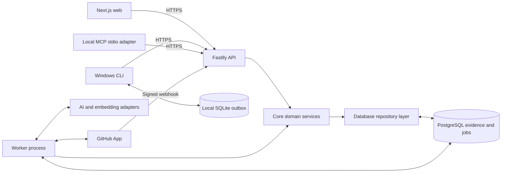
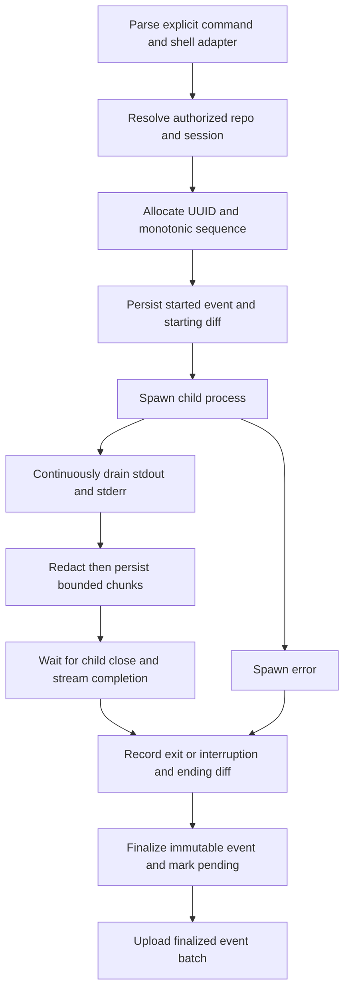

# Memvora architecture

Status: target architecture for the scratch TypeScript build. See [ROADMAP.md](ROADMAP.md) for the distinction between starter and delivered features.

## Runtime and ownership boundaries



Web, CLI and MCP never connect directly to the database. The API and worker share domain code and schema but have distinct process lifecycles. Domain modules call one another in process. Shared PostgreSQL ownership and transactions keep this a modular monolith, even though there are multiple executable applications.

| Workspace            | Responsibility                                                                    | Allowed dependencies                           |
| -------------------- | --------------------------------------------------------------------------------- | ---------------------------------------------- |
| `apps/web`           | Next.js App Router interface, web session presentation, timeline and recall       | contracts and API client; no direct DB access  |
| `apps/api`           | Fastify routes, authentication, validation, request limits, transport mapping     | contracts, core, db, server adapters           |
| `apps/cli`           | Command parsing, Windows capture, local persistence, pairing, sync, ask           | contracts and API client; local SQLite adapter |
| `apps/mcp`           | Read-only stdio tools and bounded results                                         | contracts and API client; no shell execution   |
| `apps/worker`        | Queue lifecycle, job handlers, retry and graceful shutdown                        | core, db, provider adapters                    |
| `packages/contracts` | Versioned DTOs and TypeBox runtime schemas                                        | no application or DB imports                   |
| `packages/core`      | Identity/access, GitHub, capture ingestion, memory, retrieval, lifecycle services | contracts and explicit ports; server-only      |
| `packages/db`        | Drizzle schema, migrations, scoped queries and transaction adapters               | contracts where useful; no client imports      |

Supporting utility packages can be added when genuinely shared. Avoid creating a package for every function or allowing web code to import server secrets through a convenience barrel export.

## Why these choices

| Decision                        | Why                                                                                                    | Cost and review trigger                                                                                       |
| ------------------------------- | ------------------------------------------------------------------------------------------------------ | ------------------------------------------------------------------------------------------------------------- |
| TypeScript throughout           | Shared language, types and validation contracts across website, CLI, API and MCP                       | Types alone do not validate network data; keep runtime schemas. A rewrite alone is not a measured speed gain. |
| Next.js UI plus Fastify API     | Rich web interface plus a stable API for three clients; explicit Node process for hooks and middleware | Additional process versus a web-only backend. Keep business logic out of route components.                    |
| Modular monolith                | Transactions, simpler debugging and fewer distributed failure modes for a small team                   | Enforce module boundaries; do not let one oversized service own every concern.                                |
| Separate worker                 | Slow imports, provider calls and retries cannot delay evidence acknowledgement                         | Requires a long-running host, queue observability and idempotent effects.                                     |
| PostgreSQL + Drizzle            | Relational ownership, scoped indexes, migrations and transactional evidence writes                     | Review generated SQL, composite ownership constraints and query plans.                                        |
| PostgreSQL full-text + pgvector | Exact errors remain searchable; semantic recall can find differently worded failures                   | Embeddings add cost and schema/model-version concerns; lexical fallback remains available.                    |
| pg-boss                         | Durable jobs in the same PostgreSQL operational footprint                                              | Verify same-transaction enqueue integration; do not assume two independently committed clients are atomic.    |
| Local SQLite outbox             | Capturing continues offline; immutable rows enable exact acknowledgement                               | Local disk limits, schema migration and crash recovery are application work.                                  |
| Local stdio MCP                 | Small read-oriented adapter with minimal hosting/auth complexity                                       | Host credential storage and protocol discipline matter; remote MCP requires a separate authorization design.  |

## Domain modules

`identity` resolves stable users, sessions, device credentials and workspace ownership. `access` computes current allowed repositories and fences deleted workspaces. `github` validates deliveries and syncs repository context. `capture` validates and persists immutable executions. `memory` derives versioned summaries and evidence links. `retrieval` performs scoped search and answer assembly. `lifecycle` handles revocation, deletion and retention.

All modules receive an explicit request or job context containing trusted principal/workspace identifiers. Client-supplied workspace IDs are selectors, not proof of ownership. Repository IDs must resolve within that context.

## Write flows

### GitHub intake and import

1. Read bounded raw webhook bytes and verify HMAC using constant-time comparison.
2. Validate event/delivery identifiers and supported event shape.
3. Start transaction; insert unique delivery ID; enqueue new durable import work using that transaction; commit.
4. Return 2xx only after durable intake. Duplicate deliveries return 2xx without duplicate effects. Failure returns an error and requires application-owned/manual redelivery.
5. Worker checks current installation access, fetches a bounded page/tree/diff, filters artifacts, and writes the result with its checkpoint atomically.
6. Force-push or unusable comparison triggers bounded tree reconciliation. Deleted and renamed paths update indexes while old referenced evidence retains its provenance according to retention policy.

### Windows command capture



Direct executable invocation preserves argument arrays. Shell scripts, `.cmd` wrappers and shell built-ins use a documented adapter with tested quoting, never a naive joined command string. Record shell name and mode. Noninteractive mode must state its stdin policy. Do not claim support for prompts, password entry or full-screen tools until PTY mode is accepted.

Redaction needs carryover across chunk boundaries. Apply rules before local persistence, again defensively at ingestion, and before provider submission. Persist redaction/truncation metadata. Output thresholds stop persistence, not stream draining; otherwise the child can deadlock. Process termination and signals need explicit Windows behavior and accurate interrupted status.

### Transactional ingestion

```text
authenticate -> authorize repo -> validate envelope and limits
BEGIN
  lock workspace row; verify active status and credential generation
  verify current repository grant
  for each immutable finalized event:
    insert unique(workspace_id, event_id)
    if conflict: compare canonical payload digest
      same digest -> reuse existing event
      different digest -> rollback conflict
    attach scoped artifacts for new event
    enqueue idempotent enrichment for new evidence in this transaction
COMMIT
return exact committed event IDs
```

The first API contract uses atomic batches: a validation/payload conflict rejects the entire batch. A lost response can cause a complete safe resend. Future partial-acceptance support must be a versioned contract, not a silent change in semantics.

The queue adapter must participate in the actual database transaction. Implement this through a supported pg-boss transaction/database adapter, or use a transactional domain-outbox row and a separate idempotent dispatch stage. Do not claim atomicity merely because events and jobs live in one database.

### Enrichment

1. Claim job with bounded concurrency; load a bounded evidence snapshot and input version.
2. Call provider through an adapter with timeout, budget and retry classification.
3. Validate the structured summary and every source ID against supplied evidence. Reject unsupported citations and excessive output.
4. Start final-write transaction; lock workspace and memory target; check active status, generation, current grants and unchanged input version.
5. Write an idempotent summary version, evidence links and compatible embedding/index records; mark ready; commit.
6. Discard stale output. Retry transient failures; mark permanent or exhausted failures explicitly. Keep raw evidence available.

## Read flow

```text
question + optional repository filter
  -> authenticate and resolve current allowed repositories
  -> lexical/exact and optional vector queries WITH scope predicates
  -> merge/rank bounded candidates
  -> expand authorized linked source records
  -> bounded evidence bundle
  -> cited answer OR insufficient evidence
```

Workspace, repo and activity restrictions belong inside candidate SQL, not only an output filter. Apply them again when opening source detail. Never enrich an unauthorized candidate into an AI prompt and then hide it in the UI. Cache keys include principal/workspace, access generation, repo filters, evidence version and retrieval configuration. Disable cross-user answer caching initially if these guarantees are not implemented.

Retrieved repository text and command output are untrusted content. Delimit it as evidence; never let it request new tools, alter credentials, widen access, or override instructions. MCP tools expose retrieval, not execution.

## Revocation, deletion and concurrency

Repository access removal blocks reads and writes before asynchronous reindexing/cleanup. Confirmation of current installation access is not the same as user authority to bind an installation.

Workspace deletion locks and marks `deleting`, increments a generation, revokes credentials and commits. Reads and writes deny non-active status. Cancel queued jobs, purge derived records then source evidence, and retain a minimal tombstone/generation record. A running worker or old local outbox must lock/check the fence in its final transaction and reject stale work. Cancellation alone does not prevent resurrection. Describe backup retention separately from deletion of live data.

## Deployment and operation

- Web: Next.js-supported host; communicate to API over HTTPS.
- API: persistent Node process with schema limits, readiness checks and graceful shutdown.
- Worker: independent persistent process using the same release/schema compatibility contract.
- Database: PostgreSQL supporting the required pgvector version and queue schema, connection pooling and backups.
- Windows: CLI and local MCP; local SQLite and credential-store support.

Use separate development/test/production configuration, least-privilege credentials, environment validation, request/job IDs, safe structured logs and migrations before starting incompatible new code. Health checks must distinguish process liveness from database/provider readiness; provider outages should not make evidence capture unavailable.

Measure ingest latency, sync lag, queue oldest age, retries, provider latency/cost, retrieval relevance, unauthorized-denial counts and capture truncation. Do not log raw evidence to obtain these measurements.

## When to extract services

Stay modular until evidence justifies a split. Candidates are enrichment for CPU/provider isolation and GitHub ingestion for large concurrent imports. A split is warranted by sustained queue-age/latency problems, independent scaling or release ownership, or a required trust boundary. Define a versioned event contract, idempotency, ownership and observability before extraction. The website, CLI and MCP are adapters, not separate owners of memory. Multiple services do not inherently make the product faster.
